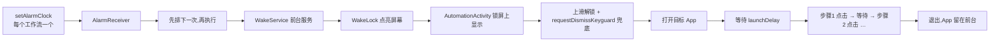

# AutoTouch

到点自动点亮屏幕 → 模拟上滑解锁 → 打开指定 App → 按顺序点击多个坐标。

支持**多个工作流**，每个工作流可独立开关、独立配置时间与重复规则、独立配置点击步骤。

目标环境：Android 11（minSdk 24 / targetSdk 30），锁屏为「仅上滑、无密码」。

## 编译

```bash
./gradlew assembleDebug      # 产物 app/build/outputs/apk/debug/app-debug.apk
./gradlew testDebugUnitTest  # 日期规则的单元测试
```

用 Android Studio 直接打开工程也可以（需要 JDK 17 + Android SDK 33）。

## 首次配置（每台手机一次）

1. **无障碍服务** —— 手势注入的唯一途径，必须开启。
2. **悬浮窗权限** —— Android 10+ 禁止后台服务直接弹界面，此权限是系统官方豁免条件。
3. **忽略电池优化** —— 避免定时被系统推迟。

主界面顶部会实时显示三项状态，红色表示尚缺。

## 工作流

主界面列出所有工作流（按执行时间排序）：

- 右侧开关 → 启用 / 关闭（关闭时立即取消它的闹钟）
- 点击一行 → 编辑
- 长按一行 → 删除

编辑页包含：

| 字段 | 说明 |
| --- | --- |
| 名称 | 仅用于列表展示 |
| 目标应用 | 从已安装应用列表选择，用 `getLaunchIntentForPackage` 启动，不依赖桌面图标位置 |
| 执行时间 | 24 小时制 |
| 重复方式 | 每天 / 周一至周五 / **法定工作日** / 自定义星期 |
| 打开应用后等待 | 毫秒，给 App 冷启动留时间（默认 3000） |
| 点击步骤 | 任意多步，每步 = X、Y、**之后等待**（毫秒） |

### 坐标怎么填

两种方式，任选：

- **手动填写**：直接输入屏幕像素坐标，可用开发者选项「指针位置」核对。
- **点屏幕取坐标**（推荐）：点步骤里的「点屏幕取坐标」→ 应用退到后台，左上角出现红色「取点」悬浮球 → 切到目标应用 → 点悬浮球 → 点要操作的位置 → 自动记录并跳回编辑页填好 X/Y。长按取点层可取消。

悬浮球可拖动，不会挡住要点的位置。取点依赖悬浮窗权限，缺失时会引导去系统设置授予。

「保存并立即执行一次」可以马上就验证整条链路，不用等到设定时间。

### 法定工作日

按国务院办公厅每年发布的放假安排判断：

- 自动跳过周末和法定节假日
- 自动识别**调休补班**（周末要上班的日子）
- 内置 2024–2027 年数据，来源 [NateScarlet/holiday-cn](https://github.com/NateScarlet/holiday-cn)（每条都标注了 gov.cn 通知链接）

数据在 [ChinaWorkCalendar.kt](app/src/main/java/com/local/autotouch/ChinaWorkCalendar.kt)，只记录与「周一到周五上班」默认规则不一致的日期，所以表很小。国务院一般在每年 11 月公布次年安排，届时按同样格式补一年即可；超出数据范围时界面会提示，并退化为「周一至周五」。

## 执行链路



代码分布：

| 文件 | 职责 |
| --- | --- |
| [Workflow.kt](app/src/main/java/com/local/autotouch/Workflow.kt) | 数据模型、重复规则判定、下次触发时刻 |
| [WorkflowStore.kt](app/src/main/java/com/local/autotouch/WorkflowStore.kt) | SharedPreferences + JSON 持久化 |
| [ChinaWorkCalendar.kt](app/src/main/java/com/local/autotouch/ChinaWorkCalendar.kt) | 法定工作日 / 节假日判定 |
| [Scheduler.kt](app/src/main/java/com/local/autotouch/Scheduler.kt) | 每个工作流独立排闹钟 / 取消 |
| [AlarmReceiver.kt](app/src/main/java/com/local/autotouch/AlarmReceiver.kt) | 到点触发，先排下一次再执行 |
| [WakeService.kt](app/src/main/java/com/local/autotouch/WakeService.kt) | 前台服务 + WakeLock 点亮屏幕 |
| [AutomationActivity.kt](app/src/main/java/com/local/autotouch/AutomationActivity.kt) | 解锁 → 开 App → 顺序执行步骤 |
| [AutoAccessibilityService.kt](app/src/main/java/com/local/autotouch/AutoAccessibilityService.kt) | `dispatchGesture` 上滑与点击 |
| [CoordPickerService.kt](app/src/main/java/com/local/autotouch/CoordPickerService.kt) | 悬浮球取点：全屏取点层、坐标回传、任务拉回前台 |
| [PickStore.kt](app/src/main/java/com/local/autotouch/PickStore.kt) | 取点临时状态（跨进程/跨页面可靠） |
| [MainActivity.kt](app/src/main/java/com/local/autotouch/MainActivity.kt) | 权限状态 + 工作流列表 |
| [WorkflowEditActivity.kt](app/src/main/java/com/local/autotouch/WorkflowEditActivity.kt) | 工作流编辑 |

## 已知限制

- **带 PIN / 密码 / 图案的锁屏无法自动解锁**：Android 从系统层面禁止辅助服务在安全锁屏上注入手势或输入密码。
- 建议两个工作流的触发时间至少间隔 1 分钟：同一时刻触发会互相打断（后触发的会重启自动化界面）。
- 坐标是屏幕绝对像素，换手机或改分辨率需重填。
- 取点时若目标应用是横屏，取到的坐标仍是当时的屏幕坐标系，执行时也需保持同样的屏幕方向。
- 部分国产 ROM（小米/华为/OPPO/vivo）还需额外开启「自启动」「后台弹出界面」，否则到点被拦截。
- `setAlarmClock` 会在状态栏显示闹钟图标，这是它能精确穿透 Doze 的原因，属正常现象。
- targetSdk 刻意保持 30（避开 Android 12+ 对前台服务类型、后台启动的新限制），仅用于个人侧载。
