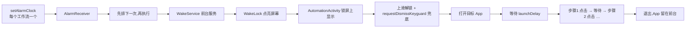

# AutoTouch

到点自动点亮屏幕 → 模拟上滑解锁 → 打开指定 App → 按顺序点击多个坐标。

支持**多个工作流**，每个工作流可独立开关、独立配置时间与重复规则、独立配置点击步骤。

目标环境：Android 11（minSdk 24 / targetSdk 30），锁屏为「仅上滑、无密码」。

## 编译

```bash
./gradlew assembleDebug      # 产物 app/build/outputs/apk/debug/app-debug.apk
./gradlew testDebugUnitTest  # 日期规则的单元测试
```

用 Android Studio 直接打开工程也可以（需要 JDK 17 + Android SDK 33）。

## 首次配置（每台手机一次）

1. **无障碍服务** —— 手势注入的唯一途径，必须开启。
2. **悬浮窗权限** —— Android 10+ 禁止后台服务直接弹界面，此权限是系统官方豁免条件。
3. **忽略电池优化** —— 避免定时被系统推迟。

三、四项是可选的数据源增强，见下文「法定工作日」。

主界面顶部会实时显示三项状态，红色表示尚缺。

## 工作流

主界面列出所有工作流（按执行时间排序）：

- 右侧开关 → 启用 / 关闭（关闭时立即取消它的闹钟）
- 点击一行 → 编辑
- 长按一行 → 删除

编辑页包含：

| 字段 | 说明 |
| --- | --- |
| 名称 | 仅用于列表展示 |
| 目标应用 | 从已安装应用列表选择，用 `getLaunchIntentForPackage` 启动，不依赖桌面图标位置 |
| 执行时间 | 24 小时制 |
| 重复方式 | 每天 / 周一至周五 / **法定工作日** / 自定义星期 |
| 打开应用后等待 | 毫秒，给 App 冷启动留时间（默认 3000） |
| 点击步骤 | 任意多步，每步可选类型：**点击坐标** 或 **退出应用**，均带「之后等待」（毫秒） |

### 坐标怎么填

两种方式，任选：

- **手动填写**：直接输入屏幕像素坐标，可用开发者选项「指针位置」核对。
- **点屏幕取坐标**（推荐）：点步骤里的「点屏幕取坐标」→ 应用退到后台，左上角出现红色「取点」悬浮球 → 切到目标应用 → 点悬浮球 → 点要操作的位置 → 自动记录并跳回编辑页填好 X/Y。长按取点层可取消。

悬浮球可拖动，不会挡住要点的位置。取点依赖悬浮窗权限，缺失时会引导去系统设置授予。

### 步骤类型

每个步骤可下拉切换：

| 类型 | 行为 |
| --- | --- |
| 点击坐标 | 在该坐标点一下（X/Y 必填，可点「点屏幕取坐标」获取） |
| 退出应用 | 回到桌面，可选是否结束后台进程，让下次启动是冷启动 |

选中「退出应用」后，该行的 X/Y 和取点按钮会自动隐藏，并出现勾选项：

- **回桌面后结束后台进程**（默认勾选）—— 真正杀掉进程，释放内存
- 取消勾选 —— 只回到桌面，应用仍在后台，下次启动是热启动

「之后等待」对两种类型都有效，可用来给下一个步骤留时间。

结束进程用 `killBackgroundProcesses`。刚回桌面时系统会认为应用还「可见」而忽略这次清理，所以按 0.4s / 0.9s / 1.6s / 2.6s / 4s / 6s / 9s / 12s / 15s 递增重试九次，只要有一轮在它真正沉到后台后命中就够了；同时会尝试隐藏接口 `forceStopPackage`，普通应用会被拒绝并静默忽略，个别定制 ROM 放行。

实测（Android 11 模拟器，目标 Clock）：勾选后进程数归 0，取消后进程仍在。

仍有一种情况杀不掉：目标应用正在跑**前台服务**（音乐播放、闹钟响铃、导航），系统会按进程优先级保留它。这是 Android 机制，非 root 无法强制结束。

「保存并立即执行一次」可以马上就验证整条链路，不用等到设定时间。

### 法定工作日（自动获取）

判定顺序，前面的优先：

1. **手机日历**里明确标注的日期 —— 授权读取日历后生效，离线可用，与你在日历 App 里看到的一致
2. **联网自动拉取**的官方数据 —— 启动时后台更新，每天最多一次，覆盖当年及未来两年；落盘缓存，断网继续用
3. **内置** 2024–2027 年官方数据（来源 [NateScarlet/holiday-cn](https://github.com/NateScarlet/holiday-cn)，每条标注 gov.cn 通知）
4. **农历推算** —— 按内置农历表（2000–2099）算出春节、端午、中秋，加上元旦/劳动节/国庆/清明，适用于任何年份
5. 兜底：周一至周五上班

#### 手机日历（可选）

主界面点「读取手机日历中的节假日」授权 `READ_CALENDAR` 即可。识别分两步：

1. **名称识别** —— 日历显示名 / 账户名 / 账户类型 含「节假日 / 假期 / 法定 / 假日 / 节日 / 调休 / Holiday / 中国 / MIUI / 小米 / HyperOS / EMUI / ColorOS…」
2. **内容嗅探** —— 名称认不出来时，看该日历一年内是否有 ≥5 条可识别的整日事件、且跨 ≥3 个不同月份。个人日程很难同时满足，避免误判

读到的都是**整日事件**（或时长接近整日的定时事件，兼容部分 ROM），不会把「下午 3 点开会」当成放假。

**任何一步都没识别出来**：点旁边的「诊断」按钮，会列出手机上全部日历及其账户、整日事件数、可识别条数，并允许**手动勾选**哪个日历是节假日表。选完保存即生效；点「自动识别」可恢复默认。诊断内容可一键复制，方便反馈机型差异。

标题判定：含「班」→ 调休补班；含「休 / 放假」或是法定节日名（元旦、春节…国庆）→ 放假；其它忽略。
「国庆节补班」这类同时含节日名的补班事件，会先按「班」判为上班。

不同手机的差异：

| 机型 | 情况 |
| --- | --- |
| 小米 / HyperOS | 日历账户类型通常含 `miui`，能被名称识别；若日历 App 把节假日存在自己的私有库里（不经 CalendarContract 暴露），则读不到，请用「诊断」确认 |
| 华为 / 荣耀 / OPPO / vivo | 多数自带节假日日历，含调休补班 |
| 原生 Android / 海外版 | 通常没有该日历，此层自动跳过 |
| Google 日历 | 需手动订阅「Holidays in China」，且只有放假、没有调休 |
| 小米日历 | 若在「设置」里关闭了「显示节假日/农历」，需先开启 |

找不到或不授权都不影响使用，会继续用下面的网络 / 内置 / 农历数据。

「周几」由 `java.util.Calendar` 直接算，不需要任何数据。

- 1、2、3 三层带**调休补班**信息，最准确
- 第 4 层只有法定假日、不含调休，属于最后的离线兜底（国务院一般在每年 11 月公布次年安排，联网后会自动补上）

数据源自带多个镜像（jsDelivr / fastly / gcore / GitHub raw），国内网络下 GitHub raw 常连不通，会按顺序自动切换。主界面顶部显示当前数据来源与覆盖年份，也可手动点「重新获取节假日数据」。

数据逻辑见 [ChinaWorkCalendar.kt](app/src/main/java/com/local/autotouch/ChinaWorkCalendar.kt)，网络层见 [HolidayRepository.kt](app/src/main/java/com/local/autotouch/HolidayRepository.kt)。

## 执行链路



代码分布：

| 文件 | 职责 |
| --- | --- |
| [Workflow.kt](app/src/main/java/com/local/autotouch/Workflow.kt) | 数据模型、重复规则判定、下次触发时刻 |
| [WorkflowStore.kt](app/src/main/java/com/local/autotouch/WorkflowStore.kt) | SharedPreferences + JSON 持久化 |
| [ChinaWorkCalendar.kt](app/src/main/java/com/local/autotouch/ChinaWorkCalendar.kt) | 法定工作日判定：手机日历 / 网络 / 内置表 / 农历推算四层 |
| [PhoneCalendarSource.kt](app/src/main/java/com/local/autotouch/PhoneCalendarSource.kt) | 读手机节假日日历：名称识别 + 内容嗅探 + 手动指定 |
| [HolidayRepository.kt](app/src/main/java/com/local/autotouch/HolidayRepository.kt) | 多镜像自动拉取节假日数据并缓存 |
| [AutoTouchApp.kt](app/src/main/java/com/local/autotouch/AutoTouchApp.kt) | 启动时载入缓存并后台更新，更新后重排闹钟 |
| [Scheduler.kt](app/src/main/java/com/local/autotouch/Scheduler.kt) | 每个工作流独立排闹钟 / 取消 |
| [AlarmReceiver.kt](app/src/main/java/com/local/autotouch/AlarmReceiver.kt) | 到点触发，先排下一次再执行 |
| [WakeService.kt](app/src/main/java/com/local/autotouch/WakeService.kt) | 前台服务 + WakeLock 点亮屏幕 |
| [AutomationActivity.kt](app/src/main/java/com/local/autotouch/AutomationActivity.kt) | 解锁 → 开 App → 顺序执行步骤 |
| [AutoAccessibilityService.kt](app/src/main/java/com/local/autotouch/AutoAccessibilityService.kt) | `dispatchGesture` 上滑与点击 |
| [CoordPickerService.kt](app/src/main/java/com/local/autotouch/CoordPickerService.kt) | 悬浮球取点：全屏取点层、坐标回传、任务拉回前台 |
| [PickStore.kt](app/src/main/java/com/local/autotouch/PickStore.kt) | 取点临时状态（跨进程/跨页面可靠） |
| [MainActivity.kt](app/src/main/java/com/local/autotouch/MainActivity.kt) | 权限状态 + 工作流列表 |
| [WorkflowEditActivity.kt](app/src/main/java/com/local/autotouch/WorkflowEditActivity.kt) | 工作流编辑 |

## 已知限制

- **带 PIN / 密码 / 图案的锁屏无法自动解锁**：Android 从系统层面禁止辅助服务在安全锁屏上注入手势或输入密码。
- 建议两个工作流的触发时间至少间隔 1 分钟：同一时刻触发会互相打断（后触发的会重启自动化界面）。
- 坐标是屏幕绝对像素，换手机或改分辨率需重填。
- 取点时若目标应用是横屏，取到的坐标仍是当时的屏幕坐标系，执行时也需保持同样的屏幕方向。
- 部分国产 ROM（小米/华为/OPPO/vivo）还需额外开启「自启动」「后台弹出界面」，否则到点被拦截。
- 离线且某年官方数据未获取时，只能推算法定假日，**调休补班日不准确**，界面会用黄字提示。
- `setAlarmClock` 会在状态栏显示闹钟图标，这是它能精确穿透 Doze 的原因，属正常现象。
- targetSdk 刻意保持 30（避开 Android 12+ 对前台服务类型、后台启动的新限制），仅用于个人侧载。
